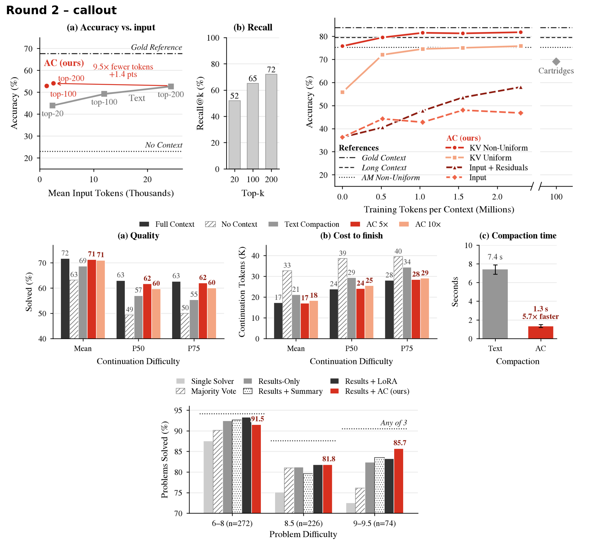
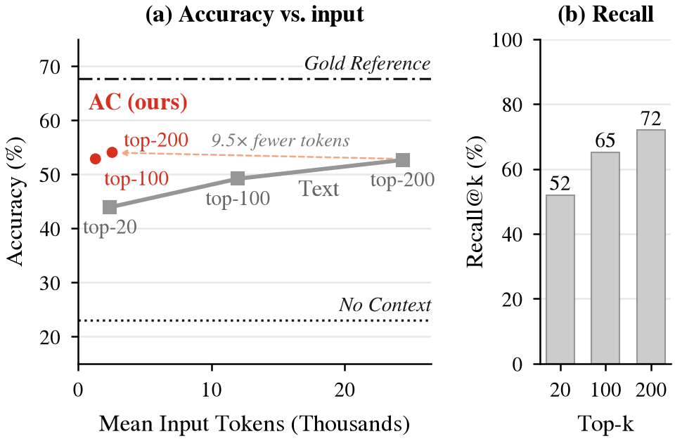
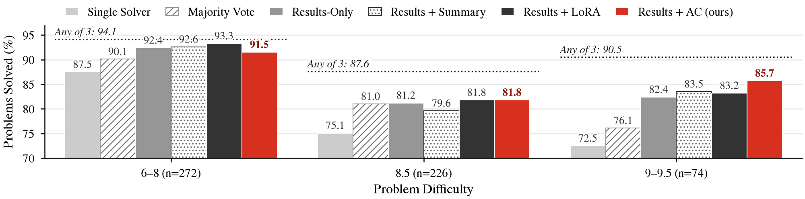

# Evaluation section: proposed fixes and figure identity

Proposals for the `@AI` TODOs in `paper/03_evaluation.tex` (MLSys, due Oct 30): checked numbers, wording fixes, and a shared figure style. A reviewer agent agreed on the style. Nothing in `paper/` is edited yet. I'll apply whatever you accept.

## 1. Figure identity (recommended)

The current figures share no visual language. "Ours" is orange in retrieval and multi-agent, orange and green in corpus compression, and blue in compaction, where red marks the *baseline*. They are also drawn about 7.5 in wide and then shrunk into a 3.25 in column, so their text prints at about 4–5 pt.

**The proposal:** one signature colour for ours, greys for everything else, and figures drawn at their real print width.



- **Signature colour.** Ours is red-vermilion `#D7301F` in every figure. AC variants use a light `#F4A582` or dark `#8C1A0E` shade, each with its own marker. In corpus compression, KV channels are solid lines and input channels dashed, so the line style itself carries meaning.
- **Baselines.** Greys only (`#333333`, `#969696`, `#CCCCCC`), with hatching for the 4th and 5th baselines. The greys stay out of vermilion's lightness band, so ours still stands out in grayscale. The reviewer also checked that ours stays distinct for red-blind readers; the earlier crimson didn't.
- **References.** Thin near-black lines with a fixed meaning: dash-dot = gold, dashed = long context, dotted = no context, ceilings and AM. They are labelled in italics, either on the line or in a "References" legend.
- **Type.** STIX (Times), matching the body text. Axis labels and panel titles are 8 pt, ticks, legends and annotations 7 pt, and nothing is smaller than 6.5 pt. Panel titles are bold "(a) …", only on multi-panel figures.
- **Callouts.** At most one, in two figures: "9.5× fewer tokens, +1.4 pts" in retrieval and "5.7× faster" in compaction. Each is measured against the strongest baseline shown and matches the text.

**Second choice:** the same style with no callouts: [`mocks_r2/sheet_r2_plain.png`](mocks_r2/sheet_r2_plain.png).

**Directions considered and not recommended:** sheets for all four first-round directions are in `mocks_r1/`.
- **A, crimson accent:** became the recommendation once the colour changed (`sheet_A_accent.png`).
- **B, warm vs. cool:** five similar blues and a top legend that takes space (`sheet_B_warmcool.png`).
- **C, story:** a shaded "headroom" band and dense callouts are clutter, and two of its deltas were wrong (`sheet_C_story.png`).
- **D, tinted panel:** looks like default R output, and teal ours is weak in grayscale (`sheet_D_tinted.png`).

**What each figure TODO gets:**
- **Retrieval:** larger fonts; a recall@k side panel. Recall is the share of questions with *both* supporting paragraphs in the BM25 top k: 52 / 65 / 72% at k = 20 / 100 / 200 on the 500 test questions.
- **Corpus compression:** the references are grouped in their own legend. Within them, AM Non-Uniform is listed after Gold and Long Context, so the two references sit together. Cartridges stays on the broken axis.
- **Compaction:** "Text summary (9B)" → **Text Compaction**; "1/5", "1/10" → **AC 5×**, **AC 10×**; panel (c) is relabelled to match.
- **Multi-agent:** narrower bars, larger fonts, and a hatched pattern to tell apart the 6 arms.

<article class="decision" data-tressoir-decision data-decision-state="unresolved" aria-labelledby="evalprop-style-q">
  <header class="decision-header">
    <div>
      <h3 class="decision-title" id="evalprop-style-q">Which figure direction should I build the final figures in?</h3>
      <p class="decision-context">Check one or more. I'll regenerate all four figures from the source data and copy them into <code>paper/figures/</code>.</p>
    </div>
    <span class="decision-state" data-decision-indicator role="status" aria-live="polite">Unresolved</span>
  </header>
  <fieldset class="decision-options">
    <legend class="visually-hidden">Decision answers</legend>
    <label class="decision-option">
      <input type="checkbox" data-tressoir-input="evalprop.style.r2callout">
      <span><strong>Round 2 with callouts (recommended)</strong><small>Vermilion identity; one callout in retrieval, one in compaction.</small></span>
    </label>
    <label class="decision-option">
      <input type="checkbox" data-tressoir-input="evalprop.style.r2plain">
      <span><strong>Round 2 plain</strong><small>Same identity, no callouts.</small></span>
    </label>
    <label class="decision-option">
      <input type="checkbox" data-tressoir-input="evalprop.style.other">
      <span><strong>Something else / another round</strong><small>Say what to change below (colour, font, legend placement…).</small></span>
    </label>
  </fieldset>
  <div class="field decision-feedback">
    <label for="evalprop-style-response">Free Response</label>
    <textarea id="evalprop-style-response" rows="2" data-tressoir-input="evalprop.style.feedback"
      data-tressoir-autogrow="2:6" placeholder="Add anything the choices miss…"></textarea>
  </div>
</article>

### Round 3 (Oct 25, after your feedback)

**Retrieval.** The loud arrow becomes a thin, light dashed link with a small grey note. The alternative is the earlier dotted same-k links ([`mocks_r2/r2_links_retrieval.png`](mocks_r2/r2_links_retrieval.png)).



**Multi-agent.** A number on every bar, drawn as a double-column `figure*` 1.7 in tall, with decimals. Integers lose real differences: 81.0 vs 81.2 both print as 81, and AC's 91.5 rounds to 92, next to Results-Only's 92.4. Decimals win.



Other versions for comparison:
- [`r3_wide_int`](mocks_r2/r3_wide_int_multiagent.png): wide, integers.
- [`r3_col_int`](mocks_r2/r3_col_int_multiagent.png): single column, integers.
- [`r3_col_dec_rot`](mocks_r2/r3_col_dec_rot_multiagent.png): single column, decimals rotated.

**Text.** The edits are applied to `paper/03_evaluation.tex` in the working tree only (not committed). They keep your sentences and change only numbers, errors and grammar. The original is backed up in the job's temp folder.

## 2. Numbers: draft vs. data

These are exact values read from each figure's source data. Bold rows change the claim rather than only the precision.

| Section | Draft says | Data says | Source |
|---|---|---|---|
| Retrieval | No context 22%, gold 68% | **23.1%**, **67.7%** | `PAPER_CORPUS_RETRIEVAL_QA/figs/results.json` (eval500, 3-pass mean) |
| Retrieval | Text 42 / 48 / 50% at k = 20 / 100 / 200 | **43.9 / 49.2 / 52.7%** at 2.4k / 12.0k / 24.4k tokens | same |
| Retrieval | AC 52% at 1.2k (k = 100); 54% vs 50% at 2.5k (k = 200) | **52.9%** at **1.3k**; **54.1%** vs **52.7%** at **2.6k** vs 24.4k | same |
| Retrieval | (new) | AC at k = 100 already matches text at k = 200 (52.9 vs 52.7%) with about 19× fewer tokens | same |
| Corpus | Long context 79%, gold 85% | 79.5%, **83.8%** | `PAPER_AM/results.json` |
| Corpus | AC KV Non-Uniform = AM before training (75%) | 75.8% (our harness) vs 75.3% (AM's code) | same |
| Corpus | 79% at 0.5M; 82% at 1M | 79.5% at 0.52M; **81.5%** at 1.04M; 81.8% at end of epoch (2.3M) | same |
| Corpus | Cartridges 68% | about 69% (read off AM Fig. 3; we plot 69) | same |
| Corpus | KV Uniform 55% → non-uniform start "after 2.5M" | 55.8% → 75.8% after **2.3M** | same |
| Corpus | Input / Input + Residuals: 35% → 45% / 55% | **36.3%** → **46.8% / 58.0%** | same |
| **Corpus** | "ACs are the only techniques that exceed the long-context reference" | Final 3-pass mean 81.1 vs long context 80.0 (10 passes): paired 95% CI −0.9 to +3.2 points, so the lead is **not significant**. Suggest "reach" or "match or slightly exceed". | `IB/STATE.md` (Oct 21, 12:17Z) |
| Compaction | P75 numbers (55.3 vs 62.7%, +6.3k; 62.0% +0.4k; 60.0% +1.0k) | all correct | `PAPER_COMPACTION/figs/fig_compaction_mvp.json` |
| Compaction | 7.4 s vs 1.3 s, "5.5x faster" | 7.4 / 1.3 = **5.7×** | `RESULTS_SO_FAR.md` |
| Compaction | (missing) | Timing was measured on 27B-written prefixes; the accuracy panels use 9B-written ones. Say so in the caption. | same |
| Multi-agent | Synthesis gap 7 / 11 / 18% | 6.6 / **12.5** / 18.0 | `paper/figures/tab_tqa_mvp.tex` |
| **Multi-agent** | "3–5 different seeds … (3 at lower difficulties, 5 at higher)" | **Every problem has exactly 3 solver runs.** The 3 vs. 5 is how many times the *synthesizer* is sampled (3 for 6–8, 5 for 8.5 and up), averaged. | `PAPER_TRAJ_QA/scripts/tqa_unified_table_sumres.py` |
| Multi-agent | Difficulty "from 1–9"; test range "6–9" | The top bucket holds 72 problems at 9.0 and 2 at 9.5, so "1–9" is wrong; please confirm the dataset's full scale. Test range 6–9.5. | `TMP/PAPER_TRAJ_QA/node_sync/dmhard/sample.json` |

**Your two figure TODO questions:**
- **"What should any of 3 be in the 5-seed cases?"** It stays "Any of 3". There are always 3 solver runs, and the ceiling uses those same 3 runs.
- **"Should ≥ 9 be 9 or 9–9.5?"** The bucket is 72 problems at 9 and 2 at 9.5. I'd label it "9–9.5 (n = 74)". "≥ 9" is also correct.

## 3. Wording, grammar, and incorrect information

Changes I'd make, section by section, with the numbers from §2 included.

**Retrieval Q/A**
- **Sample sentence:** "sampled at random from the its validation split" → "sampled at random from its validation split (disjoint from the 200 questions we used for development)".
- **Training data:** "our training set is the whole train split" → "training questions come from the train split". We trained on subsets of it, not all 90k questions.
- **Hyphen:** "single hop BM25" → "single-hop BM25".
- **Averaging:** "We report the average response accuracy of three completions" → "We report accuracy averaged over three sampled completions per question".
- **Comparisons, incomplete method:**
  - Say how ACs are produced: "the top-k passages go to the encoder in k/20 calls of 20 passages, each with the question first".
  - Say that the 9B reader carries a LoRA adapter. Reviewers will ask, because the text baseline is the untuned 9B.
  - State that thinking is off for all arms.
- **Comparisons, wording:**
  - "described \cref" → "described in \cref".
  - "The gold reference only given the right documents" → "The gold reference is given only the two supporting paragraphs."
- **Results paragraph (proposed),** `paper/03_evaluation.tex`:

```latex
The no-context floor is 23.1\% and the gold-context ceiling 67.7\%. Given the top-$k$ passages
as text, the model achieves 43.9\%, 49.2\% and 52.7\% for $k=20$, 100 and 200 (2.4k, 12.0k and
24.4k input tokens). Given the same passages as ACs, it achieves 52.9\% at $k=100$ with 1.3k
tokens and 54.1\% at $k=200$ with 2.6k tokens. ACs at $k=100$ already match text at $k=200$
(52.9\% vs.\ 52.7\%) with about 19$\times$ fewer tokens. \cref{fig:evalRetrievalQA}b shows why
more passages help: both supporting paragraphs are retrieved for 52\% of questions at $k=20$,
65\% at $k=100$ and 72\% at $k=200$, and ACs capture this recall at a tenth of the token cost.
```

- **Caption:** "Retrieval Q/A on HotpotQA (500 validation questions, mean of 3 completions). (a) Accuracy against the reader's mean input tokens; labels give the number of retrieved passages $k$. (b) BM25 recall@$k$: both supporting paragraphs in the top $k$."

**Latent Corpus Compression**
- **Grammar:**
  - "the aim to" → "the aim is to".
  - "Cartidges" → "Cartridges".
  - "a question-answering benchmark on long health document" → "a question-answering benchmark over long clinical documents".
  - "four long 60k tokens documents" → "four 60k-token documents".
- **Model name:** "Qwen-4B-Instruct-2507" → "Qwen3-4B-Instruct-2507", three times. "Qwen-4B-Instruct-2507 Instruct model" also says "Instruct" twice.
- **Caption is wrong:** it reads "Retrieval Q/A Results". Proposed: "Latent corpus compression on LongHealth (400 questions, Qwen3-4B-Instruct-2507, 10$\times$ compression). Accuracy against self-study training tokens per context. Cartridges is placed at 100M tokens, the low end of the 100--150M that AM reports."
- **Results:** the §2 numbers, plus "exceed" → "reach" for the long-context claim (bold row in §2).
- **Uniform-KV sentence:** "only reaches the starting non-uniform starting point after 2.5M training tokens" → "only reaches the non-uniform starting point (75.8\%) after 2.3M training tokens".

**Agent Trajectory Compaction**
- **Headings:** "Setup" → "Overview." to match the other sections. Add the missing periods after the bold run-in headings here and in Multi-Agent.
- **Grammar:**
  - "leading costlier resolution token-wise" → "making the task costlier to finish in tokens".
  - "as an good proxy" → "as a proxy".
  - "ask the model resume" → "ask the model to resume".
  - "with an additional 50k more tokens" → "within 50k additional tokens".
  - "used in the most harnesses" → "used in most harnesses".
  - "the agent with ACs solve" → "the agent with ACs solves".
  - Add the missing period after "despite the compaction".
- **Define P50 and P75:** "While ACs perform better at the mean and medium" → "ACs do better on average and on the hardest half (P50)". Define P50 and P75 once: the hardest 50% / 25% of tasks, ranked by the original run's tokens after the cut.
- **Hardware name:** "RTX 6000 Pro" → "RTX PRO 6000 (Blackwell)".
- **Speedup:** "5.5x faster and effectively enable agent-resumption" → "about 5.7$\times$ faster, which enables resumption without delay".
- **Caption:** add the P50/P75 definition and the note that timing used 27B-written prefixes.

**Multi-Agent Synthesis**
- **Seeds:** rewrite the sentence (bold row in §2): "We run 3 independent Qwen 3.5 9B solvers per problem; each synthesis method is sampled 3 times (difficulty 6–8) or 5 times (8.5 and up) and averaged."
- **Difficulty range:** "6-9 difficulty range" → "6–9.5". Fix "from 1-9" once you've confirmed the scale.
- **Grammar:**
  - "The results are show" → "shown".
  - "but actually underperforms compared to the other baselines" → "but trails the other synthesis baselines (92.4–93.3\%)".
  - "from the just the results" → "from just the results".
  - "As a ideal ceiling" → "As an ideal ceiling".
- **Synthesis gap:** 11% → 12.5%.
- **Suggested addition:** the significance at 9–9.5. AC vs. Results-Only is +22 / −10 paired task-seed wins (sign test p = .05), and AC vs. Majority Vote +41 / −4 (p < .001).

<article class="decision" data-tressoir-decision data-decision-state="unresolved" aria-labelledby="evalprop-text-q">
  <header class="decision-header">
    <div>
      <h3 class="decision-title" id="evalprop-text-q">Which text changes should I apply to 03_evaluation.tex?</h3>
      <p class="decision-context">I'll edit the submodule's working tree only; you review the diff and push to GitHub/Overleaf yourself (or ask me to).</p>
    </div>
    <span class="decision-state" data-decision-indicator role="status" aria-live="polite">Unresolved</span>
  </header>
  <fieldset class="decision-options">
    <legend class="visually-hidden">Decision answers</legend>
    <label class="decision-option">
      <input type="checkbox" data-tressoir-input="evalprop.text.all">
      <span><strong>All of §2 and §3</strong><small>Numbers, incorrect information, grammar, captions.</small></span>
    </label>
    <label class="decision-option">
      <input type="checkbox" data-tressoir-input="evalprop.text.numbers">
      <span><strong>Numbers and incorrect information only</strong><small>Leave the prose for your own pass.</small></span>
    </label>
    <label class="decision-option">
      <input type="checkbox" data-tressoir-input="evalprop.text.adjust">
      <span><strong>Adjust</strong><small>Say which items to skip or change below.</small></span>
    </label>
  </fieldset>
  <div class="field decision-feedback">
    <label for="evalprop-text-response">Free Response</label>
    <textarea id="evalprop-text-response" rows="2" data-tressoir-input="evalprop.text.feedback"
      data-tressoir-autogrow="2:6" placeholder="Add anything the choices miss…"></textarea>
  </div>
</article>

## 4. Left alone for now (per the TODO text)

- **Compaction:** "Expand discussion to more quantiles" (deferred, low priority).
- **Training and Ablations:** "Don't fill this section yet".
- **Multi-agent:** "Make denser, then increase fonts" has no `@AI` tag, but the mock already does it. Ignore it if you'd rather do that one yourself.
- **Other sections:** outside this TODO's scope; not read for edits.

## Files

- **Paper:** the submodule is at `paper/`, at commit `e1f48b8` "Eval First Draft". It is staged in the parent repo, not committed.
- **Round-2 mocks:** `mocks_r2/make_r2.py`. It draws at print width from the checked values, and once you choose a direction it becomes the final figure script.
- **Round-1 directions:** `mocks_r1/`.
