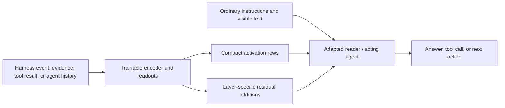

# Activation Context: harness–model co-design through learned latent channels

**Purpose:** standing research context for presentations and planning. The research intent below is durable; the evidence snapshot is dated September 23, 2026. This document describes a research program, not a claim that every application has been validated.

## Research question and intended contribution

**Does harness–model co-design benefit from introducing alternative, co-trained latent channels and internal interventions at harness events, so agents can receive richer information without expanding their ordinary text context proportionally?**

The harness controls retrieval, tool execution, agent communication, and context management. These decisions determine what information reaches the model and in what form. We want to make that interface learnable: the harness chooses an information source and a communication budget; a trained encoder and reader learn how to communicate through it.

The primary ambition is **better task quality**: retain useful details that text truncation, short summaries, or narrow retrieval would discard, and let the agent use them. An acceptable fallback is **comparable quality at lower end-to-end cost**—less reader context, memory, latency, or compute after accounting for the encoder. A useful result should improve the quality–cost tradeoff, rather than merely demonstrate that tensors can be passed between models.

The broad contribution would be an agent harness and model that are trained to work together through additional information channels. Context compression is the first concrete application of that idea.

## The proposed interface

**Activation Context (AC)** is the current implementation. A side model encodes a harness-provided payload into a bounded number of continuous vectors, called **rows**. The reader consumes those rows alongside ordinary text. Learned heads can also provide layer-specific residual additions at the corresponding row positions inside the reader; these are the **interventions**.

The channel can carry a payload together with its task, message roles, and tool frame. It can supplement a short visible tool response or agent message. User instructions, ordinary conversation, and action syntax continue to use text.

The encoder, readouts, and reader adapters are trained together to make this representation useful. The reader need not reconstruct the original text before answering or acting. Different events may benefit from different payload selection, budgets, or readouts; whether they should share one representation is an empirical question.

**Compression ratio means rows per source token.** At 1/16, roughly 32k source tokens become 2k reader positions, with framing and rounding affecting the exact count. These positions still occupy reader context and require computation. The side encoder also processes the source and appended summary rows, while deep interventions carry additional tensors. A 16× reduction in reader positions is therefore not a 16× reduction in total memory, transmitted bytes, or runtime.

## Harness events we want to support

| Event | Information the latent channel could preserve | Desired benefit |
|---|---|---|
| Retrieval-augmented QA | Retrieved documents, code, tables, and distractors | More usable evidence within a fixed reader budget |
| Tool results | Long command output, search results, traces, or execution state | Preserve details otherwise truncated from the visible response |
| Agent communication | A delegated agent's relevant trajectory and tool evidence, alongside its answer | Richer transfer than a short natural-language handoff alone |
| Context compaction | Earlier turns, observations, and intermediate work | Continue long tasks while retaining information needed later |
| Long-input handling | A whole source sequence or independently encoded pieces | Scale source coverage while controlling reader context and encoding cost |

These are related research settings, not established quality wins. Runtime support and short end-to-end tests exist for agent communication and compaction; the strongest current learning evidence is from synthesized RAG QA. Recursive/nested channels are supported as a representation, but their quality at larger depth remains a separate question.

## Architecture and training strategy

The current family uses a Qwen3.5 encoder and reader, frozen base weights, rank-128 LoRA adapters, and learned AC modules. The main QA experiments use a **2B encoder → 9B reader**. The encoder reads the source and produces summary representations; dedicated readouts map them into reader input rows and, for deep models, residual deltas at full-attention layers. Deep residual heads start at zero when newly initialized. Trained heads are preserved when continuing from a checkpoint.

The canonical recipe uses **no input/content pooling**: source content is not downsampled before the side-model pass. Learned aggregation to form the output summary rows is still part of the architecture. Both one-sequence encoding and separate-passage encoding are being studied.

Training has two complementary purposes:

1. **Reconstruction establishes a general information channel.** The frozen Golden target is 50M reconstruction tokens across tool outputs, code, documents, math, and web text; whole documents/trajectories are held out. It specifies a 2B encoder, 2B/4B/9B/27B readers, and coverage of 1/10–1/30 compression. Gold-token SFT and a no-context behavior-preservation penalty train the channel. The intended held-out reconstruction gate is below 0.2 nats/token. The 50M accounting across the reader/ratio sweep remains unspecified; the entire Golden sweep is not already complete.
2. **Task-aware training teaches useful selection and use of information.** QA trains on synthesized answers; trajectory settings can supervise retained assistant outputs or distill a full-context teacher. Where KL distillation is used, teacher targets are fixed before updates rather than following the changing reader. A separate no-context KL penalty protects existing reader behavior against a fixed base-reader reference; it does not assume the model should be unable to answer without evidence.

The AC trainer can jointly update encoder, heads, and reader adapters. The separate agent-policy trainer currently replays captured AC rows with the encoder frozen. Thus, “co-trained” describes the research strategy and the AC training path; it does not imply that every existing policy-training loop backpropagates through every component.

Reconstruction must preserve arbitrary token-level detail, whereas QA or compaction can sometimes select only what a later task needs. We hypothesize that reconstruction is the harder compression objective in this sense. That is not a theorem: selective tasks may still require difficult reasoning, exact details, or information whose later relevance is unknown.

## Data and evidence standards

Task-aware QA uses **independently synthesized questions**, drawn from mixed raw code, mathematical/scientific material, web/document text, financial tables, and legal/office material. Generation is programmable over chunks, longer windows, whole documents, and related sources. Scalable banks are reusable, interruptible, and mixed within successive batches. Current sources include questions generated by 9B and 27B models; the intended final oracle is 27B.

The protected unit for task-aware evaluation is the **evaluation question and its supervision**, regardless of an upstream dataset's split name. Shared raw source corpora are allowed. Evaluation questions, answer keys, and task-conditioned solutions are excluded from generation/training inputs. Development questions support monitoring; independent confirmation questions are withheld from adaptive decisions. This is distinct from the document-held-out requirement of Golden reconstruction.

The comparisons needed to substantiate the research claim are:

- Full text, no context, and AC on the same questions and evidence; full text includes the same distractors.
- Frozen initial-reader baselines and separately labeled matched-reader controls, to distinguish channel effects from reader adaptation. A quality claim also needs an appropriately trained text-only system: a reader specialized for AC is not automatically a strong full-text baseline.
- Relevant text-only alternatives at comparable budgets, such as fewer retrieved passages or a textual summary.
- Input rows alone versus rows plus deep interventions, and whole-sequence versus separate-piece encoding where useful.

Report **task success and actual answer quality** alongside loss. Gold-answer NLL is a convenient continuous learning signal, but it is teacher-forced and sensitive to reference wording; it can miss errors in free generation. Reconstruction's 0.2 NLL gate is not a universal QA quality threshold. Efficiency measurements must include encoding, interventions, reader execution, and applicable caching costs. Training progress is reported as **unique questions × epochs**, with evidence/distractor budgets stated for long-context runs.

## Current evidence and remaining questions

As of September 23, a checkpoint trained on 42,000 unique QA questions once can consume approximately 32k source tokens in **one encoder pass**, without additional long-context training. On a repeatedly inspected 100-question development cohort, it achieved **0.6314 answer NLL**, versus **0.5744 with its paired full-context reader** and **1.8413 without context**, measured on the same L40S runtime. Qualitative review found **66/87 correct AC answers versus 81/87 for full context**; 13 reference concerns remain separately visible. The small-looking NLL gap therefore still accompanies a material answer-quality gap. AC scoring took 4.63 minutes for 100 items and peaked at 28.27 GiB allocated GPU memory. These are readout measurements, not complete serving-cost measurements.

A matched-L40S follow-up measures **0.6792 NLL and 59/87 correct for separately encoded passages**, versus **0.6314 and 66/87 for one encoder pass**, using identical weights, questions, 32k evidence and total latent rows. Native 2k evidence measures 0.5548 NLL. The strong checkpoint was trained with merged short inputs, so retaining that layout may help explain monolithic encoding's advantage; this is an interpretation, not an isolated mechanism test. Most added long context consists of retrieved distractors, so this result supports long-input handling and information transfer, not yet reasoning over distributed required evidence. It is preliminary development evidence, not a final independent benchmark result.

**QA specialization does not preserve the original reconstruction performance.** On the same 420 original held reconstruction passages at 1/16, freshly evaluated P2 scores **0.1064 NLL / 96.48% token accuracy**, versus **1.0812 / 73.57% after 42k QA questions**. The 50k cosine continuation and 960-example monolithic32k adaptation remain near **1.08 / 73.6%**. All seven source groups degrade. This measures the full encoder–reader pair under the original reconstruction interface; encoder and reader contributions remain unseparated. It establishes loss of verbatim-copying behavior while useful QA communication remains, and makes retention across tasks an explicit research question. [Reconstruction findings](IB/ARTIFACTS/FIRST_TASK_AWARE_FINETUNING/RECONSTRUCTION_RETENTION.md).

The main open questions are how quality scales with fresh data and training schedule; how much long-context adaptation is needed; when deep interventions or piecewise encoding help; and whether the same approach improves actual agent tasks. A further question is whether LoRA capacity is sufficient or broader parameter updates are worthwhile. We should not present saturation, an optimal layout, or a universal compression ratio as settled.

**Presentation framing:** we are testing whether a learnable harness–model interface can give agents more useful information per unit of context and computation. Early QA results establish a usable latent communication channel. The stronger claim—better agent outcomes or comparable outcomes at lower total cost—requires the corresponding task and efficiency evidence.

For implementation authority, see [AC canon](IB/CANON/ACTIVATION_CONTEXT_CANON.md) and [agent-training canon](IB/CANON/AGENT_TRAINING_CANON.md). For evolving experimental evidence, see [the PI brief](IB/ARTIFACTS/FIRST_TASK_AWARE_FINETUNING/PI_INSIGHTS_20260923.md) and [current state](IB/STATE.md).
